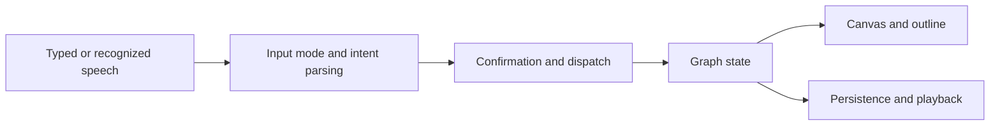

# Technical case study: SpeechFlow

## Problem
Capturing and organizing ideas can require frequent context switching between typing, diagram editing and presentation.

## Approach
SpeechFlow combines a visual directed graph with typed and spoken commands, distinct input modes, explicit confirmation for destructive operations and local persistence.


Conceptual data flow.

## Evaluation
[Voice tests](tests/voice.test.cjs) exercise command interpretation and dispatch. [Testing instructions](TESTING.md) distinguish simulated recognition from live microphone checks. [Architecture](ARCHITECTURE.md) describes modular state and graph concerns.

```sh
npm ci
node --test tests/voice.test.cjs
npm run build:web
npm run test:native
```

## Engineering decisions
Separate dictation from commands, preserve legacy maps through schema migration, and use confirmation and recovery paths to limit unintended edits.

## Limitations
No clinical accessibility outcomes or speech-recognition accuracy claims are established. Real-device microphone and native behavior require separate verification.

## Reproducible fixture demonstration

The synthetic phrase `Create bubble Ship the MVP` should preserve the label `Ship the MVP`. `connect one to two` should dispatch one graph connection, and `clear map` should leave the graph untouched when confirmation is denied. The fixture exercises parsing and dispatch with simulated input.

```sh
node --test tests/voice.test.cjs
```

## Resume summary
Built a voice-enabled graph workspace with intent classification, command safety controls, schema migration and automated regression tests.

## Verified CI evidence — 2026-11-25

Six voice tests and eleven native packaging tests passed; web build passed. Live speech recognition and real-device behavior were not tested.

- [GitHub Actions run](https://github.com/robbiecalvin/speechflow/actions/runs/45641425924)
- [Tested revision](https://github.com/robbiecalvin/speechflow/commit/74e334f68f305bac0cc1bbad7598a17240109aa4)

Results were inspected from completed job logs. They apply to the linked revision and executed checks only.
