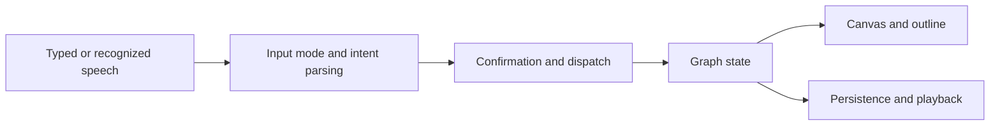

# Technical case study: SpeechFlow

## Problem
Capturing and organizing ideas can require frequent context switching between typing, diagram editing and presentation.

## Approach
SpeechFlow combines a visual directed graph with typed and spoken commands, distinct input modes, explicit confirmation for destructive operations and local persistence.


Conceptual data flow.

## Evaluation
[Voice tests](tests/voice.test.cjs) exercise command interpretation and dispatch. [Testing instructions](TESTING.md) distinguish simulated recognition from live microphone checks. [Architecture](ARCHITECTURE.md) describes modular state and graph concerns.

```sh
npm ci
node --test tests/voice.test.cjs
npm run build:web
npm run test:native
```

## Engineering decisions
Separate dictation from commands, preserve legacy maps through schema migration, and use confirmation and recovery paths to limit unintended edits.

## Limitations
No clinical accessibility outcomes or speech-recognition accuracy claims are established. Real-device microphone and native behavior require separate verification.

## Resume summary
Built a voice-enabled graph workspace with intent classification, command safety controls, schema migration and automated regression tests.
